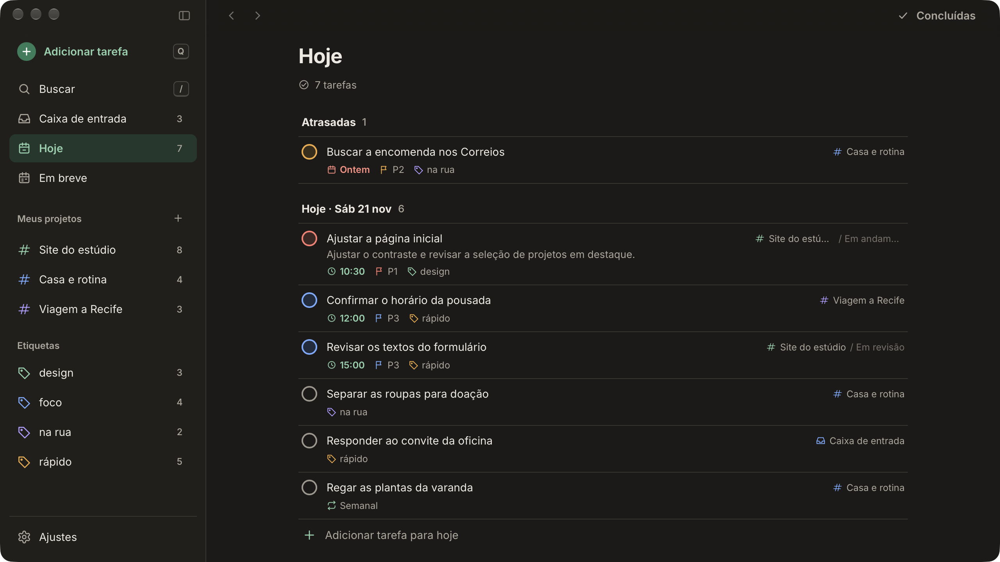

# Feito

**English** | [Português (Brasil)](README.pt-br.md)

Feito is a personal task app you host on your own computer or server. Capture tasks in Inbox, plan your day with Today and Upcoming, and organize projects in lists or boards. The app supports subtasks, labels, priorities, and recurring tasks, as well as Todoist imports and data exports. Task and project data is stored encrypted. The interface defaults to English, with other languages available in Settings.



## Getting started

- **[Web](apps/web/README.md)**: install on your computer or server with Docker Compose and access it from a browser, including on mobile.
- **[Desktop](apps/desktop/README.md)**: download the installer for macOS, Windows, or Linux. Use it on its own, with tasks stored on this computer, or sync with a web installation.

## Development

Use Node.js 24 and pnpm 10. For desktop development, also install stable Rust and the [Tauri prerequisites](https://v2.tauri.app/start/prerequisites/).

```sh
pnpm install --frozen-lockfile
pnpm dev:desktop
```

`pnpm typecheck`, `pnpm test`, and `pnpm build` check both apps. See [Operations and maintenance](docs/03-operations.md) for web development mode, tests, and releases.

## Documentation

- [Operations and maintenance](docs/03-operations.md)
- [Architecture](docs/01-architecture-and-stack.md)
- [API](docs/02-backend-endpoints.md)
- [Motion and interaction](docs/04-motion-and-interaction.md)
- [Brand](docs/05-brand.md)
