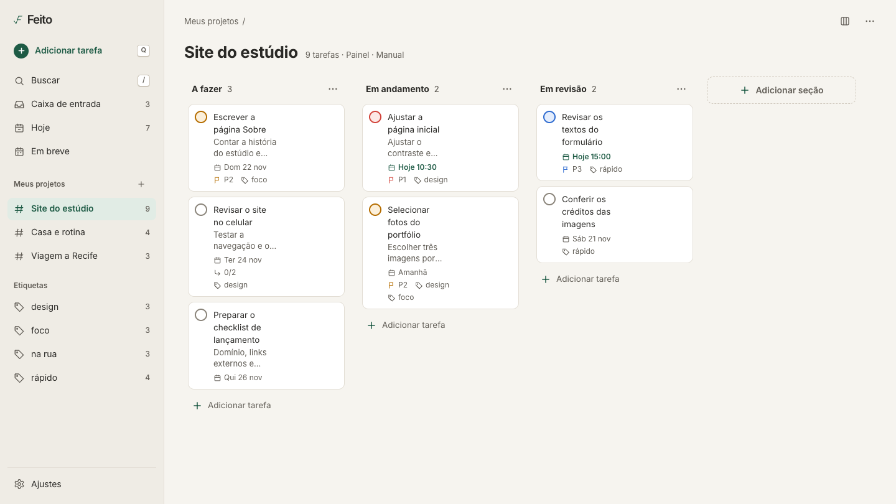

# Feito

Feito é um app de tarefas pessoais que você hospeda na sua máquina ou no seu servidor. Capture tarefas na Caixa de entrada, planeje o que fazer em Hoje e Em breve e organize seus projetos em listas ou painéis. O app oferece subtarefas, etiquetas, prioridades e recorrência, além de importação do Todoist e exportação de dados. Os dados de tarefas e projetos são armazenados cifrados no PostgreSQL.

O [Feito para desktop](apps/desktop/README.md) usa a mesma interface e pode funcionar localmente ou sincronizar com uma instalação web por HTTPS.


<details>
<summary>Ver um projeto em painel e a interface no celular</summary>




</details>

## Instalação

Você precisa de Docker com o plugin Docker Compose, Git e OpenSSL. Execute os comandos em um shell como Bash ou Zsh. Para configurar um PostgreSQL externo, o Docker também executa o cliente `psql` usado no comando abaixo.

O Docker Compose baixa as imagens públicas do Feito no GitHub Container Registry. As imagens usam `linux/amd64` e exigem emulação em hosts ARM.

```sh
git clone https://github.com/danilo-alm/feito.git
cd feito

FEITO_ENV="$HOME/.config/feito/feito.env"
```

Para instalar num servidor público, substitua `https://localhost:3000` pelo domínio HTTPS do Feito, por exemplo `https://feito.example.org`. Na opção A, aponte o DNS para o servidor e deixe as portas 80 e 443 acessíveis para que o Caddy emita o certificado. Na opção B, a Cloudflare atende o HTTPS e o servidor não precisa de portas abertas. Use o mesmo endereço para abrir o app depois de instalar.

O script gera as credenciais e as chaves de criptografia. Mantenha o arquivo fora da pasta do projeto, preserve-o ao atualizar a instalação e guarde uma cópia segura. Você precisará das chaves para recuperar os dados cifrados de um backup.

### Opção A — PostgreSQL no Docker

```sh
scripts/new-env.sh "$FEITO_ENV" --origin https://localhost:3000
FEITO_COMPOSE=(-f compose.prod.yaml)
docker compose "${FEITO_COMPOSE[@]}" --env-file "$FEITO_ENV" up -d --wait
```

O Compose inicia o PostgreSQL 18, cria as credenciais do banco na primeira inicialização do volume e aplica as migrações. Depois, siga para [Criar a primeira conta](#criar-a-primeira-conta).

### Opção B — Supabase com Cloudflare Tunnel

Um único arquivo, [`compose.prod.tunnel.yaml`](compose.prod.tunnel.yaml), sobe o migrador, o app e o `cloudflared`. O banco é um PostgreSQL externo com o certificado verificado. Nenhum contêiner publica portas no host. Para a configuração inicial, obtenha o host, a porta, o nome do banco e um login administrativo que possa criar usuários e conceder permissão de criação de schemas.

```sh
FEITO_COMPOSE=(-f compose.prod.tunnel.yaml)
```

#### Parâmetros para Supabase

No painel do projeto Supabase, abra **Connect** e copie os dados de conexão do PostgreSQL. O banco padrão se chama `postgres`. Ambos os modos abaixo usam a porta `5432`.

Em uma rede IPv4, selecione **Session pooler** em **Connect**. Use `--supabase` para gerar as credenciais. O script pede a referência do projeto (o trecho após `postgres.` no usuário do pooler) e o host mostrado em **View parameters**.

```sh
scripts/new-env.sh "$FEITO_ENV" --origin https://localhost:3000 --supabase
```

Para passar esses dados pelo comando, acrescente `--project-ref SEU_PROJECT_REF` e `--pooler-host HOST_DO_POOLER`. Para conexão direta, use `--supabase-direct` e informe a referência quando o script perguntar ou via `--project-ref`. Os dois modos preenchem as quatro URLs automaticamente com verificação do certificado e do hostname.

| Campo | Conexão direta | Pooler Session |
| --- | --- | --- |
| Host | `db.<project-ref>.supabase.co` | Host do **Session pooler** mostrado em **Connect** |
| Usuário administrativo | `postgres` | `postgres.<project-ref>` |
| Usuário de cada URL do Feito | Nome da role, por exemplo `feito_app` | Nome da role com sufixo, por exemplo `feito_app.<project-ref>` |

Se a rede do servidor só tiver IPv4, use o pooler **Session** ou uma conexão direta com o adicional de IPv4. Use a senha do banco do Supabase no comando de inicialização. O Feito gerencia o login dos usuários pelo Better Auth. [Conexões do Supabase](https://supabase.com/docs/guides/database/connecting-to-postgres)

No painel do Supabase, abra **Database Settings → SSL Configuration → Download Certificate**. Copie o certificado para o host onde o Docker roda. Use um caminho absoluto e deixe o certificado público legível pelo usuário do contêiner. Registre o caminho no arquivo de ambiente, que continua privado. [Configuração de TLS do Supabase](https://supabase.com/docs/guides/platform/ssl-enforcement)

```sh
chmod 644 "$HOME/.config/feito/prod-ca-2021.crt"
echo "FEITO_POSTGRES_CA_FILE=$HOME/.config/feito/prod-ca-2021.crt" >> "$FEITO_ENV"
```

Se o arquivo de ambiente já existe, preserve as senhas e as chaves. Nas quatro URLs da tabela abaixo, substitua `sslmode=require` por `sslmode=verify-full&sslrootcert=/run/config/feito-postgres-ca.crt` e coloque cada URL inteira entre aspas simples.

#### Cloudflare Tunnel

No painel Zero Trust, abra **Networks → Tunnels**, escolha o túnel e copie o token do comando de instalação do conector (o valor após `--token`). Acrescente-o ao arquivo de ambiente sem aspas e sem espaços:

```sh
printf 'CLOUDFLARE_TUNNEL_TOKEN=%s\n' 'COLE_O_TOKEN' >> "$FEITO_ENV"
```

Em **Public Hostname**, aponte o domínio de `FEITO_ORIGIN` para o serviço `HTTP` com URL `app:3000`, ou seja, a Service URL `http://app:3000`. O `cloudflared` deste Compose alcança o app pela rede interna do Docker. Se o mesmo túnel tiver outro conector rodando no host ou em outro contêiner, pare-o, porque ele não alcança `app:3000` e a Cloudflare distribui as requisições entre os conectores. Ative **Always Use HTTPS** na zona para redirecionar visitas por HTTP.

#### Criar os usuários do banco e iniciar

Para outro provedor, gere primeiro o arquivo com `scripts/new-env.sh "$FEITO_ENV" --origin https://localhost:3000` e configure as URLs antes de inicializar o banco.

Se precisar ajustar as URLs, defina o host, a porta e o banco externos e conserve a senha gerada para cada usuário. No Session pooler, use o host do painel e acrescente `.<project-ref>` ao usuário em cada URL. Para outro provedor, use os parâmetros de TLS indicados por ele.

| Variável | Usuário do PostgreSQL |
| --- | --- |
| `DOMAIN_DATABASE_URL` | `feito_app` |
| `AUTH_DATABASE_URL` | `feito_auth` |
| `MIGRATION_DATABASE_URL` | `feito_migrator` |
| `IDENTITY_ADMIN_DATABASE_URL` | `feito_identity_admin` |

Em uma instalação nova, execute uma vez o script abaixo. Ele obtém o host, a porta e o banco de `MIGRATION_DATABASE_URL` e usa o usuário administrativo `postgres` ou `postgres.<project-ref>` no Session pooler. Para um provedor com outro usuário administrativo, acrescente `--admin-user USUÁRIO`.

```sh
scripts/init-external-db.sh "$FEITO_ENV"
```

Quando o `psql` pedir `Password:`, informe a senha administrativa do banco. O `psql` roda na imagem `postgres:18` e o script cria as quatro roles com as senhas geradas no arquivo.

```sh
docker compose "${FEITO_COMPOSE[@]}" --env-file "$FEITO_ENV" up -d --wait --remove-orphans
```

O serviço de migração prepara as tabelas antes de o app iniciar. `--remove-orphans` remove o contêiner do Caddy deixado por versões anteriores desta opção. Para confirmar o acesso público, `curl -sS https://feito.example.org/api/health` deve retornar `{"status":"ok"}`.

### Criar a primeira conta

Com o arquivo Compose da opção escolhida, crie a conta com seu e-mail. O comando pede uma senha provisória e o Feito solicita a troca no primeiro acesso.

```sh
docker compose "${FEITO_COMPOSE[@]}" --env-file "$FEITO_ENV" \
  run --rm cli pnpm admin account:create --email voce@example.org
```

Abra [https://localhost:3000](https://localhost:3000) ou o domínio que você configurou. Na opção A em localhost, o Caddy emite o certificado com uma autoridade local. Para o navegador confiar nela, exporte o certificado raiz e adicione-o às autoridades confiáveis do seu sistema ou navegador.

```sh
docker compose "${FEITO_COMPOSE[@]}" --env-file "$FEITO_ENV" \
  cp caddy:/data/caddy/pki/authorities/local/root.crt ./feito-local-ca.crt
```

### Atualizar ou parar

Para baixar as imagens mais recentes e atualizar a instalação, execute novamente `up -d --wait` com o mesmo arquivo de ambiente e a mesma opção de banco. Antes de atualizar, consulte as [instruções de backup e restauração](docs/03-operations.md#backup-e-restauração-isolada).

Para parar a instalação preservando os volumes do Docker:

```sh
docker compose "${FEITO_COMPOSE[@]}" --env-file "$FEITO_ENV" down
```

## Desenvolvimento

Use Node.js 24 e pnpm 10. Para abrir a janela nativa, instale também Rust estável e os pré-requisitos do Tauri.

```sh
pnpm install --frozen-lockfile
pnpm dev:desktop
```

Para rodar o web, use `pnpm dev` com os serviços e o ambiente de teste descritos no guia de operação, ou `docker compose -f compose.dev.yaml --env-file "$FEITO_ENV" up --build`. `pnpm typecheck`, `pnpm test` e `pnpm build` verificam os dois frontends. Os instaladores são gerados com `pnpm --filter @feito/desktop tauri build`.

## Documentação

- [Operação e manutenção](docs/03-operations.md)
- [Arquitetura](docs/01-architecture-and-stack.md)
- [API](docs/02-backend-endpoints.md)
- [Movimento e interação](docs/04-motion-and-interaction.md)
- [Marca](docs/05-brand.md)
- [Migração do monorepo](docs/migracao-monorepo.md)
