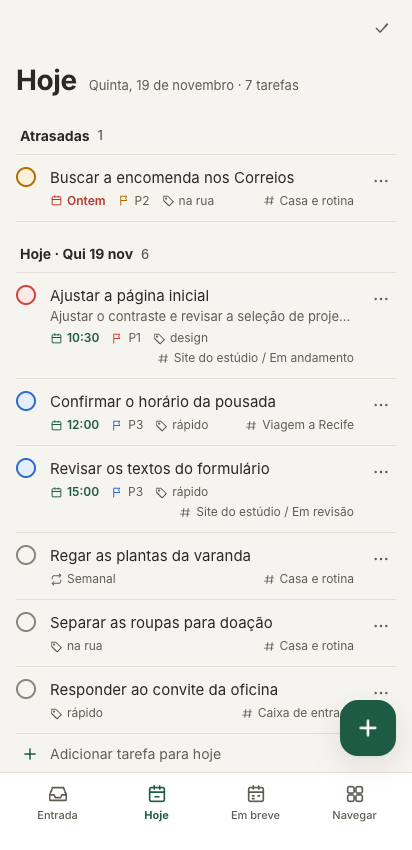

# Feito

Feito é um app de tarefas pessoais que você hospeda na sua máquina ou no seu servidor. Capture tarefas na Caixa de entrada, planeje o que fazer em Hoje e Em breve e organize seus projetos em listas ou painéis. O app oferece subtarefas, etiquetas, prioridades e recorrência, além de importação do Todoist e exportação de dados. Os dados de tarefas e projetos são armazenados cifrados no PostgreSQL.


<details>
<summary>Ver um projeto em painel e a interface no celular</summary>




</details>

## Instalação

Você precisa de Docker com o plugin Docker Compose, Git e OpenSSL. Execute os comandos em um shell como Bash ou Zsh. Se for usar um PostgreSQL externo, instale também o cliente `psql` na máquina que fará a configuração.

```sh
git clone https://github.com/danilo-alm/feito.git
cd feito

FEITO_ENV="$HOME/.config/feito/feito.env"
scripts/new-env.sh "$FEITO_ENV" https://localhost:3000
```

Para instalar num servidor público, substitua `https://localhost:3000` pelo domínio HTTPS do Feito, por exemplo `https://feito.example.org`. Aponte o DNS para o servidor e deixe as portas 80 e 443 acessíveis para que o Caddy emita o certificado. Use o mesmo endereço para abrir o app depois de instalar.

O script gera as credenciais e as chaves de criptografia. Mantenha o arquivo fora da pasta do projeto, preserve-o ao atualizar a instalação e guarde uma cópia segura. Você precisará das chaves para recuperar os dados cifrados de um backup.

### Opção A — PostgreSQL no Docker

```sh
FEITO_COMPOSE=compose.prod.yaml
docker compose -f "$FEITO_COMPOSE" --env-file "$FEITO_ENV" up -d --build --wait
```

O Compose inicia o PostgreSQL 18, cria as credenciais do banco na primeira inicialização do volume e aplica as migrações. Depois, siga para [Criar a primeira conta](#criar-a-primeira-conta).

### Opção B — PostgreSQL externo

Use um banco acessível pelo host e pelos contêineres do Feito. Para a configuração inicial, obtenha o host, a porta, o nome do banco e um login administrativo que possa criar usuários e conceder permissão de criação de schemas.

#### Parâmetros para Supabase

No painel do projeto Supabase, abra **Connect** e copie os dados de conexão do PostgreSQL. O banco padrão se chama `postgres`. Ambos os modos abaixo usam a porta `5432`.

| Campo | Conexão direta | Pooler Session |
| --- | --- | --- |
| Host | `db.<project-ref>.supabase.co` | Host do **Session pooler** mostrado em **Connect** |
| Usuário administrativo | `postgres` | `postgres.<project-ref>` |
| Usuário de cada URL do Feito | Nome da role, por exemplo `feito_app` | Nome da role com sufixo, por exemplo `feito_app.<project-ref>` |

Se a rede do servidor só tiver IPv4, use o pooler **Session** ou uma conexão direta com o adicional de IPv4. Use a senha do banco do Supabase no comando de inicialização. O Feito gerencia o login dos usuários pelo Better Auth. [Conexões do Supabase](https://supabase.com/docs/guides/database/connecting-to-postgres)

#### Criar os usuários do banco e iniciar

Execute uma vez, substituindo os parâmetros pelos do seu provedor. O `psql` pede a senha administrativa no terminal. O script cria quatro usuários no PostgreSQL com as senhas geradas no `$FEITO_ENV`.

```sh
(
  set -a
  . "$FEITO_ENV"
  set +a
  PGSSLMODE=require psql -X -W --single-transaction --set=feito_external=1 \
    --host=db.example.org --port=5432 --dbname=postgres --username=postgres \
    --file=scripts/postgres-init.sql
)
```

Edite as quatro URLs já geradas em `$FEITO_ENV`. Em cada uma, troque `127.0.0.1:5432/feito` pelo host, porta e banco externos e conserve a senha gerada para aquele usuário. No pooler Session do Supabase, acrescente `.<project-ref>` ao usuário em cada URL. Para o Supabase, acrescente `?sslmode=require` ao fim das quatro URLs. Para outro provedor, use os parâmetros de TLS indicados por ele.

| Variável | Usuário do PostgreSQL |
| --- | --- |
| `DOMAIN_DATABASE_URL` | `feito_app` |
| `AUTH_DATABASE_URL` | `feito_auth` |
| `MIGRATION_DATABASE_URL` | `feito_migrator` |
| `IDENTITY_ADMIN_DATABASE_URL` | `feito_identity_admin` |

```sh
FEITO_COMPOSE=compose.prod.external.yaml
docker compose -f "$FEITO_COMPOSE" --env-file "$FEITO_ENV" up -d --build --wait
```

O serviço de migração prepara as tabelas antes de o app iniciar.

### Criar a primeira conta

Com o arquivo Compose da opção escolhida, crie a conta com seu e-mail. O comando pede uma senha provisória e o Feito solicita a troca no primeiro acesso.

```sh
docker compose -f "$FEITO_COMPOSE" --env-file "$FEITO_ENV" \
  run --rm cli pnpm admin account:create --email voce@example.org
```

Abra [https://localhost:3000](https://localhost:3000) ou o domínio que você configurou. Em localhost, o Caddy emite o certificado com uma autoridade local. Para o navegador confiar nela, exporte o certificado raiz e adicione-o às autoridades confiáveis do seu sistema ou navegador.

```sh
docker compose -f "$FEITO_COMPOSE" --env-file "$FEITO_ENV" \
  cp caddy:/data/caddy/pki/authorities/local/root.crt ./feito-local-ca.crt
```

### Atualizar ou parar

Ao atualizar o código, execute novamente `up -d --build --wait` com o mesmo arquivo de configuração e a mesma opção de banco. Antes de atualizar, consulte as [instruções de backup e restauração](docs/03-operations.md#backup-e-restauração-isolada).

Para parar a instalação preservando os volumes do Docker:

```sh
docker compose -f "$FEITO_COMPOSE" --env-file "$FEITO_ENV" down
```

## Documentação

- [Operação e manutenção](docs/03-operations.md)
- [Arquitetura](docs/01-architecture-and-stack.md)
- [API](docs/02-backend-endpoints.md)
- [Movimento e interação](docs/04-motion-and-interaction.md)
- [Marca](docs/05-brand.md)
