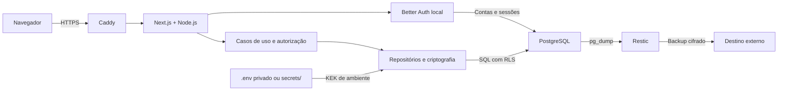
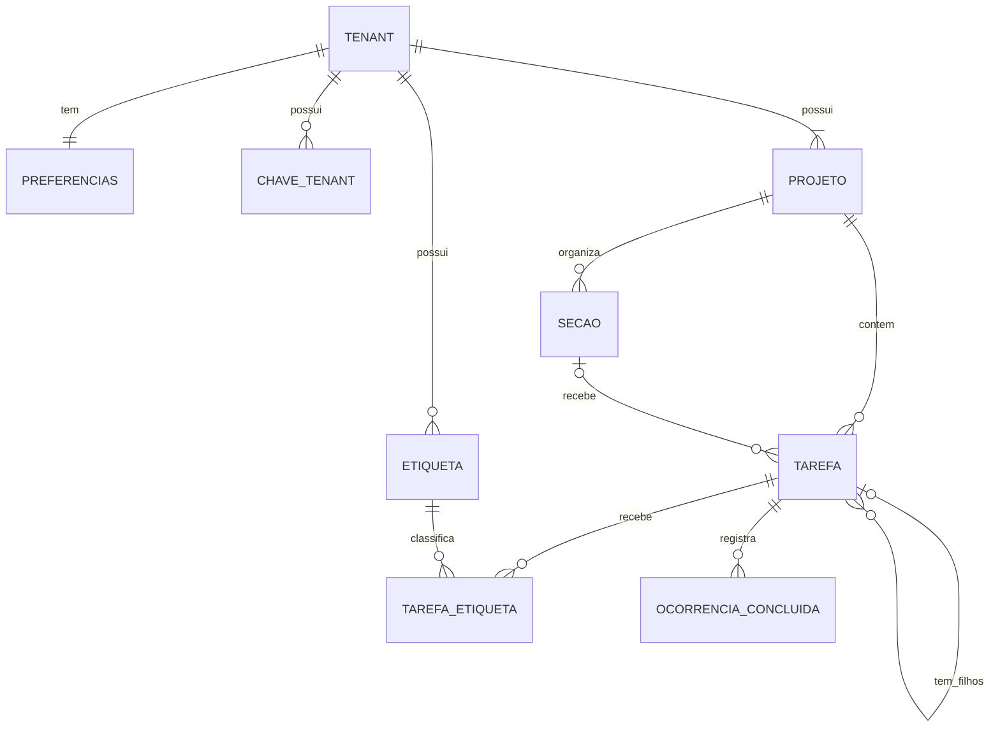

# Arquitetura e stack da aplicação de tarefas pessoais

Decisão proposta em 17 de novembro de 2026. A raiz do projeto continha somente `docs/`, sem código ou configuração inicial.

## 1. Requisitos que orientam a arquitetura

| Requisito funcional | Consequência para o desenho |
| --- | --- |
| Capturar rapidamente, organizar mais de cinco projetos por conta e consultar a agenda pelo celular ou computador. | Uma interface web responsiva, com navegação entre Caixa de entrada, Hoje, Em breve e projetos. Projetos oferecem Lista e Painel sobre as mesmas tarefas e seções. A interface atende aos temas claro e escuro. Criação e conclusão dão retorno imediato. |
| Organizar por seções e etiquetas, reordenar tarefas por arraste, mover entre colunas, criar subtarefas ao soltar uma tarefa sobre outra, arquivar projetos e reabrir concluídas. | Relações e transações no banco. Estado, posição manual e identidade da tarefa preservados nas operações que os reutilizam; destino e profundidade validados ao soltar. |
| Planejar por data civil e horário local opcional, com recorrência diária, semanal e mensal. | Relógio do domínio no fuso da conta, próxima data planejada calculada na conclusão e histórico persistido para prevenir avanço duplicado. O prazo final é uma extensão futura com significado próprio. |
| Buscar por trecho literal de título ou descrição, combinar filtros temporários e oferecer ordenação manual e automática. | Redução de candidatos por relacionamentos e avaliação dos campos cifrados em memória no servidor. |
| Isolar contas individuais e proteger os dados de cada usuário com criptografia de envelope. | Um usuário por tenant. Login local por e-mail e senha, autorização, políticas de linha e chaves de dados distintas por tenant desde a primeira versão. |
| Atender o operador e, a seu critério, amigos convidados no mesmo servidor. | Instalação exclusivamente self-hosted, com cadastro fechado e gestão de contas pelo operador do host. |
| Hospedar na própria infraestrutura e manter as chaves no servidor. | Um host Linux com Next.js e PostgreSQL. O processo da aplicação lê a chave de ambiente de um `.env` privado em tempo de execução. Um diretório `secrets/` atende instalações com vários segredos ou versões. |
| Exportar e importar todos os dados pessoais do produto. | Formato portátil versionado, restauração transacional em conta vazia e teste de ida e volta entre contas com chaves diferentes desde o MVP. |

Calendário, tabela, prazo final, filtros salvos, lixeira, arraste para reagendar entre dias e migração assistida de outras ferramentas ficam para fases futuras. Lista e Painel, incluindo arraste manual, fazem parte do MVP. Colaboração, equipes, atribuição, comentários colaborativos, papéis organizacionais e cobrança ficam fora do produto.

## 2. Decisão arquitetural

| Critério | A. Next.js integrado | B. React ou Next.js com API Fastify ou NestJS |
| --- | --- | --- |
| Desenvolvimento | Um projeto TypeScript. Páginas do servidor, ações e rotas HTTP chamam os mesmos casos de uso. | Dois pontos de entrada. A API precisa definir contratos, tratamento de erros, sessão e versionamento. Fastify oferece schemas de validação e serialização. NestJS oferece módulos, injeção de dependências e guards. |
| Manutenção e testes | Um deploy e uma matriz de integração. Exige disciplina na fronteira entre UI e servidor e na invalidação de dados. | Testes independentes e contratos explícitos ajudam quando há consumidores distintos. Exige testes de contrato, compatibilidade entre versões e mais configuração local e em CI. |
| Infraestrutura e custo | Um processo HTTP e PostgreSQL, com pools limitados por função de acesso. Um incidente nesse processo afeta a aplicação toda. | Dois serviços ou um frontend estático mais um serviço HTTP, com configuração separada de rede, sessões e telemetria. Um proxy de mesma origem pode concentrar o tráfego e somar custo operacional. |
| Desempenho | A leitura inicial chama o serviço diretamente. O servidor e o cliente compartilham o custo da renderização, conforme a tela. | React estático pode servir o shell por CDN. Cada leitura dinâmica do navegador passa pela API, com serialização e pelo menos uma chamada de rede. A API pode escalar separadamente. |
| Evolução | Módulos de domínio sem dependência de Next.js preservam uma opção de extração. Route Handlers podem atender uma API pequena no mesmo deploy. | Útil para aplicativos nativos, integrações externas com ciclo próprio ou carga sustentada que exija escalonamento independente e justifique a divisão. |

[Server e Client Components](https://nextjs.org/docs/app/getting-started/server-and-client-components), [Fastify](https://fastify.dev/docs/latest/Reference/Validation-and-Serialization/), [NestJS](https://docs.nestjs.com/).

**Adotar a alternativa A.** Um monólito modular Next.js App Router concentra autenticação, acesso ao banco e criptografia em um processo Node.js. A aplicação web é o único consumidor planejado. Interfaces diretas entre módulos atendem ao MVP com menos infraestrutura. Reavaliar a alternativa B caso apareça um consumidor independente ou a medição mostre que um módulo precisa de implantação própria.

### Renderização, mutações e navegação

- Páginas públicas simples podem ser estáticas. O layout autenticado e a carga inicial de Inbox, Hoje, Em breve e projetos usam React Server Components com leitura por requisição, autenticação e DTOs mínimos. O RSC chama o serviço diretamente, sem uma chamada HTTP para a própria aplicação. Projetos podem renderizar a mesma ordem e as mesmas relações em Lista ou Painel.
- Listas interativas, o Painel, diálogos, formulários, atalhos, datas, foco e comandos de toque usam Client Components. Estado transitório fica local. A rota representa a tela selecionada e a janela de Em breve. O campo de busca e seus critérios podem ficar no componente para evitar consultas pessoais em URLs, logs e histórico. O seletor de layout no canto superior direito alterna a apresentação sem mudar os dados do projeto.
- Expor criação, edição, conclusão, reabertura, movimentação, criação de subtarefas e ordenação como Route Handlers JSON em `/api/v1`, conforme o [guia de endpoints](02-backend-endpoints.md). O contrato HTTP permite implementar e testar o backend separado da interface. Cada rota verifica sessão, origem, entrada, profundidade, destino e autorização. Persistir reordenação apenas no modo Manual. Retornar resultado canônico e revalidar as vistas afetadas. Adotar atualização otimista nos gestos simples e restaurar a exibição se houver falha ou arraste cancelado. Em recorrência, a resposta do servidor determina a próxima ocorrência.
- A mesma API atende login e sessão locais, busca interativa por `POST`, download de exportação e prévia e confirmação de importação. A busca usa debounce e descarta respostas antigas. Exports e sessões mutáveis ficam sem cache compartilhado. Dados pessoais renderizados, respostas de busca e arquivos usam política privada `no-store` no transporte. Evitar persistência de conteúdo pessoal em service workers ou no armazenamento local do navegador.
- Recalcular a agenda ao trocar de tela, voltar à aba ou cruzar a meia-noite do fuso do perfil com a tela aberta. O servidor calcula o dia para consultas e mutações. Drag-and-drop atende mouse e toque prolongado em celular; começar o gesto móvel não pode impedir rolagem normal antes da ativação. Oferecer alvos válidos e prévias visuais, rolagem automática perto das bordas e cancelamento que restaure a posição. Teclado e menus fornecem as mesmas operações sem exigir arraste.

[Segurança de dados no Next.js](https://nextjs.org/docs/app/guides/data-security), [Route Handlers](https://nextjs.org/docs/app/getting-started/route-handlers), [React useOptimistic](https://react.dev/reference/react/useOptimistic).



## 3. Stack recomendada

| Área | Escolha e motivo | Alternativas e desvantagens |
| --- | --- | --- |
| Interface | React e TypeScript no Next.js App Router, Tailwind CSS e componentes selecionados de shadcn/ui. Manter tokens para temas claro e escuro, Lista e Painel, e controles acessíveis para diálogo, menus e navegação. Suportar foco, teclado, mouse e toque prolongado para arraste. | CSS Modules com HTML nativo reduz dependências e funciona bem para as listas. Componentes shadcn/ui copiados ficam sob manutenção do projeto. [Tailwind no Next.js](https://tailwindcss.com/docs/installation/framework-guides/nextjs), [shadcn/ui](https://ui.shadcn.com/docs). |
| Estado e formulários | Estado local React, formulário HTML para captura, `useActionState` para estado de envio e `useOptimistic` pontual. React Hook Form pode entrar no editor se campos condicionais de recorrência justificarem. | Zustand e TanStack Query acrescentariam estado e invalidação sobre a navegação existente. O estado local pede cuidado com resposta obsoleta e reconciliação entre telas. [useActionState](https://react.dev/reference/react/useActionState), [React Hook Form](https://react-hook-form.com/). |
| Backend | Next.js no runtime Node.js 24 LTS, com funções TypeScript de negócio, casos de uso e repositórios privados do servidor. A camada HTTP fica fina. | Fastify oferece separação por API e NestJS convenções de módulos. O backend integrado depende do ciclo do Next.js e exige testes dos adaptadores. [Node.js LTS](https://nodejs.org/en/about/previous-releases), [segurança de dados no Next.js](https://nextjs.org/docs/app/guides/data-security). |
| Banco | PostgreSQL 18 com chaves estrangeiras compostas, transações e Row-Level Security (RLS). | SQLite reduz administração para uma conta, porém exigiria que o isolamento com banco compartilhado ficasse na aplicação. Um banco por tenant adicionaria provisionamento, conexões e backups por conta. PostgreSQL demanda manutenção e restauração verificável. [RLS](https://www.postgresql.org/docs/current/ddl-rowsecurity.html), [constraints](https://www.postgresql.org/docs/current/ddl-constraints.html). |
| Acesso a dados | Drizzle ORM com driver `pg` e Drizzle Kit. Manter SQL explícito e revisado nas migrações futuras para roles, RLS, políticas, índices e restrições específicas. | Prisma oferece API e ferramentas próprias. SQL com `pg` apenas dá controle direto e exige mais mapeamento manual. Drizzle exige conhecimento de SQL e uso consistente do objeto de transação. [Drizzle Transactions](https://orm.drizzle.team/docs/transactions), [node-postgres](https://node-postgres.com/features/transactions). |
| Autenticação | Better Auth para e-mail e senha, sessão revogável em PostgreSQL e integração Next.js/Drizzle. Usar Argon2id com `@node-rs/argon2` e criação e recuperação de contas por comando local no piloto. | Usar scrypt padrão da biblioteca reduziria uma dependência. Implementar sessões à mão aumentaria a responsabilidade sobre cookies, revogação e defesa contra tentativas repetidas. Argon2id custa memória por tentativa e a extensão nativa exige teste no host escolhido. [Better Auth e-mail e senha](https://better-auth.com/docs/authentication/email-password), [integração Next.js](https://better-auth.com/docs/integrations/next), [adapter Drizzle](https://better-auth.com/docs/adapters/drizzle). |
| Validação | Zod nas fronteiras e domínio para invariantes entre registros. Validar entradas, arquivos versionados e resultados decifrados antes de usar o conteúdo. | JSON Schema com Ajv facilita contratos independentes de TypeScript. Zod simplifica tipos na aplicação e requer adaptação explícita para regras que dependam do banco. [Zod](https://zod.dev/). |
| Datas e recorrência | Temporal com `@js-temporal/polyfill` no servidor e `Intl` na apresentação. Regra de três frequências com função de domínio pura. | date-fns ou Day.js exigiriam convenções explícitas para datas sem hora e fusos. RRULE atende calendários interoperáveis, mas exigiria adaptar a regra mensal de fim de mês. O polyfill adiciona uma dependência que poderá ser retirada quando o runtime suportado atender aos testes. [Temporal.PlainDate](https://tc39.es/proposal-temporal/docs/plaindate.html), [polyfill](https://github.com/js-temporal/temporal-polyfill/blob/main/package.json). |
| Busca e filtros | PostgreSQL filtra candidatos por identificadores estruturais, e o Node.js decifra, normaliza, filtra e ordena o conjunto do tenant. | Busca textual PostgreSQL com texto em claro exporia conteúdo. Índices cegos favorecem alguns tipos de consulta e revelam padrões. Substrings exigiriam outro desenho. A varredura tem custo proporcional aos candidatos. |
| Criptografia | AES-256-GCM em `node:crypto`, com uma DEK exclusiva por tenant e KEK versionada no `.env` do servidor ou em `secrets/`. A abertura de chaves ocorre em memória no próprio processo. | Uma chave única para todos os payloads dificultaria isolar e rotacionar chaves de tenant. Um cofre dedicado acrescentaria operação e credenciais. No desenho local, a operação do host assume a custódia e a recuperação da KEK. [Node.js Crypto](https://nodejs.org/api/crypto.html), [NIST SP 800-38D](https://csrc.nist.gov/pubs/sp/800/38/d/final). |
| Testes | Vitest para domínio e integração com PostgreSQL real. Playwright para fluxos web, perfis de tela e downloads/imports. | `node:test` reduz dependências unitárias. Playwright e um banco dedicado aumentam o tempo de CI, mas exercitam navegação, cookies e políticas reais de linha. [Vitest](https://vitest.dev/guide/), [Playwright](https://playwright.dev/docs/intro). |
| Deploy | Docker Compose em um host Linux próprio ou VPS, com Next.js, Caddy para HTTPS e PostgreSQL em volume persistente. Usar `pg_dump` e Restic para backup cifrado fora do host. | Instalar os mesmos serviços via systemd é viável e exige configuração manual de cada um. Concentrá-los em um host reduz custo fixo e exige patches, medição de recursos e recuperação verificada. [Next.js self-hosting](https://nextjs.org/docs/app/guides/self-hosting), [Caddy HTTPS](https://caddyserver.com/docs/automatic-https), [Restic](https://restic.readthedocs.io/en/stable/030_preparing_a_new_repo.html). |
| Logs e monitoramento | Pino com lista de campos permitidos, saída local com rotação, checagem HTTPS de outro host e alertas de recursos e backup. | Coletor remoto ajuda se houver mais de um host e acrescenta armazenamento e retenção a administrar. Logs guardados apenas no host podem se perder junto com ele. [Pino](https://github.com/pinojs/pino). |

## 4. Identidade, isolamento e criptografia

### Identidade e autorização

1. Cada conta local habilitada corresponde a um tenant. A pessoa entra com e-mail e senha e encerra a sessão pelo próprio aplicativo. No login e no provisionamento, remover espaços externos e usar caixa baixa para obter o e-mail canônico. O Better Auth consulta o e-mail no esquema de identidade, com unicidade do valor canônico no banco. A associação usa o ID interno estável do usuário, e-mail é somente identificador de login. Habilitar apenas credenciais locais. A instalação piloto tem cadastro público fechado com `disableSignUp`. O titular do host cria contas por comando administrativo local, com uma instância administrativa da mesma biblioteca e adapter sem exposição HTTP. Essa instância usa o fluxo de criação da biblioteca com habilitação de cadastro restrita ao comando, entrada de senha por prompt protegido e login automático desativado. E-mail serve de login, sem exigência de servidor de e-mail nem verificação automatizada. [Better Auth e-mail e senha](https://better-auth.com/docs/authentication/email-password), [opções de registro](https://better-auth.com/docs/reference/options).
2. A biblioteca usa scrypt por padrão e permite fornecer `hash` e `verify`. Configurar Argon2id com salt aleatório por senha, parâmetros gravados no hash e o perfil inicial do exemplo oficial, 64 MiB de memória, 3 iterações, paralelismo 4 e saída de 32 bytes. Medir no host e limitar tentativas e concorrência de login. Aceitar frases-senha, com 15 a 128 caracteres como política inicial, e mensagens genéricas de erro. O hash de senha fica no esquema de identidade. Ele é independente da criptografia de envelope e trocar a senha mantém as chaves de produto. [Better Auth Security](https://better-auth.com/docs/reference/security), [configuração Argon2id](https://better-auth.com/docs/authentication/email-password#configuration), [rate limiting](https://better-auth.com/docs/concepts/rate-limit).
3. Usar sessão opaca do Better Auth em PostgreSQL, com cookie `HttpOnly`, `Secure` e `SameSite=Lax`, expiração e validação da sessão no servidor sem cache de sessão no cookie. A rota de login encaminha o cookie da biblioteca e entrega à interface apenas o resultado necessário ao fluxo. Logout revoga a sessão atual. Para recuperar uma conta, o operador verifica a titularidade e executa um comando local que recebe a nova senha por prompt protegido, aplica o mesmo hasher configurado e revoga todas as sessões na mesma transação. A desativação bloqueia a emissão e o uso de sessões e revoga as existentes. Tratar a corrida entre login e redefinição com uma revisão de credencial verificada ao emitir a sessão. A consulta continua exigindo uma conta ativa. Senhas ficam fora de argumentos, histórico, logs e arquivos de configuração. O usuário autenticado pode trocar a senha pela interface usando a senha atual. [Sessões](https://better-auth.com/docs/concepts/session-management), [cookies](https://better-auth.com/docs/concepts/cookies), [e-mail e senha](https://better-auth.com/docs/authentication/email-password).
4. Em toda leitura, mutação, busca e exportação/importação, obter o tenant do vínculo com o usuário interno da sessão verificada. Validar origem em requisições autenticadas que alterem estado. Tratar objetos de outro tenant como ausentes e retornar erros genéricos de integridade. Usar schema e credenciais PostgreSQL de escopo próprio para o adapter de identidade, sem acesso a tabelas de produto. A conta do domínio usa privilégios separados, sem leitura de credenciais.
5. No acesso ao domínio, abrir uma transação e definir o tenant autenticado com `set_config` restrito à própria transação. Todas as consultas usam essa conexão e a role de execução, inclusive quando há pool. Aplicar RLS com `USING` e `WITH CHECK` em todas as tabelas do domínio e de DEKs. Sem contexto válido, a política nega. A role de execução tem apenas permissões necessárias, sem propriedade das tabelas, `BYPASSRLS`, privilégios de migração ou de cópia de segurança. Usar `FORCE ROW LEVEL SECURITY` e separar roles administrativas. O bootstrap autenticado cria tenant, DEK ativa, preferências e Caixa de entrada de forma idempotente. FKs com `tenant_id` reforçam os limites mesmo em uma transação de escrita com erros de aplicação. [RLS](https://www.postgresql.org/docs/current/ddl-rowsecurity.html), [escopo transacional de set_config](https://www.postgresql.org/docs/current/functions-admin.html), [node-postgres Transactions](https://node-postgres.com/features/transactions).
6. RLS protege contra omissões no escopo da query. O banco confia no contexto definido pelo processo da aplicação. Autorização por caso de uso, queries parametrizadas, credenciais com privilégios mínimos e isolamento do runtime continuam essenciais. O backup administrativo é um fluxo separado e auditado.

### Administração de contas no piloto

| Opção | Benefício e custo |
| --- | --- |
| Comandos locais da aplicação | O responsável já tem acesso ao servidor e pode atender pedidos esporádicos. Os comandos usam o módulo de identidade da aplicação e as permissões da operação. O atendimento requer acesso ao host. |
| Conta administrativa com painel web | Facilita listar contas, atender pedidos recorrentes e delegar suporte sem dar acesso ao servidor. Exige autenticar o operador, autorizar cada ação no servidor, auditar alterações e testar uma superfície web privilegiada. |

**Decisão para o MVP.** Usar comandos locais para listar e criar contas, redefinir senhas, revogar sessões, desativar e reativar contas. O operador confirma a identidade do conhecido por um canal já estabelecido antes de redefinir a senha. A redefinição usa uma senha provisória exclusiva, entregue individualmente, e revoga as sessões anteriores. No próximo acesso, a pessoa troca a senha antes de entrar nas telas de tarefas. Registrar quem executou a ação, a conta afetada, o momento e o resultado. Os comandos reutilizam um serviço de identidade que pode servir ao painel no futuro.

**Quando adotar o painel.** Em uma instalação self-hosted, reavaliar quando o atendimento passar a ser frequente ou outra pessoa precisar cuidar de contas sem acesso ao host. Restringir a conta administrativa a operações de identidade, como provisionar, suspender, reativar e iniciar a recuperação de acesso. A autorização administrativa não concede acesso a tarefas, projetos, exportações ou chaves dos tenants.

### Dados protegidos e metadados

| Proteção no banco | Campos |
| --- | --- |
| Cifrados no aplicativo por tenant | Títulos e notas das tarefas no campo de descrição, nomes de projetos, seções e etiquetas, prioridade, posição manual, situação e horários de conclusão, estado de arquivamento, datas e horas planejadas, recorrência e ocorrências, além de preferências e futuros filtros salvos. Campos relacionados de uma entidade usam um payload versionado. |
| Estruturais, em colunas | UUIDs opacos de tenant, entidade e relações, inclusive arestas de etiquetas e identidade da Caixa de entrada, identificador técnico de ocorrência para idempotência, revisão para concorrência e cabeçalhos criptográficos. São usados para RLS, FKs, escopo, locking e referências. A estrutura, a contagem de linhas e os vínculos entre identificadores permanecem visíveis ao banco. |
| Operacionais | O schema de identidade guarda e-mail canônico consultável para login, ID de usuário, hash da senha e registros de sessão. Esse é o dado pessoal em claro necessário ao lookup do MVP e fica restrito ao adapter de identidade. Recibos de importação, auditoria sem conteúdo e DEKs encapsuladas também são operacionais. O disco do banco e o backup operacional são cifrados em repouso. |

### Envelope e ciclo de vida

- Criar uma KEK aleatória de 32 bytes por instalação e ambiente de dados. Cada tenant recebe sua própria DEK de 32 bytes, gerada pelo CSPRNG do Node.js. Encapsular a DEK com AES-256-GCM e persistir somente tenant, versões da DEK e da KEK, nonce, tag e texto cifrado. O AAD do envelope inclui um identificador estável da instalação, tenant, versões e o propósito de encapsulamento. A KEK vive no servidor, fora do PostgreSQL.
- Cifrar também o payload de produto com AES-256-GCM, usando a DEK autorizada, com nonce aleatório de 96 bits novo por operação e tag de 128 bits. Vale para cifragens novas, regravações e reencapsulamento. No AAD de payload, vincular identificador estável da instalação, tenant, tipo e ID do registro, versões de DEK e payload, identificadores estruturais relevantes e revisão. Usar codificação inequívoca, com finalidade distinta no AAD de envelope e de payload. Interromper a operação se a tag falhar, antes de consumir qualquer texto decifrado. [NIST SP 800-38D](https://csrc.nist.gov/pubs/sp/800/38/d/final), [Node.js Crypto](https://nodejs.org/api/crypto.html).
- Aplicar teto conservador inferior ao limite normativo da construção aleatória, com rotação antes de 2²⁴ invocações por chave, inclusive a KEK. A reserva da KEK cobre todos os tenants, ocorre antes de cifrar um envelope e contabiliza tentativas mesmo se a gravação falhar. Manter os contadores por versão no PostgreSQL, em transações curtas anteriores às de mutação. Para a DEK, reservar um bloco de invocações por operação antes do lock de escrita do tenant. Incluir tentativas de cifragem mesmo se a gravação falhar. Revalidar a DEK ativa sob o lock e repetir a reserva se a versão tiver mudado. Um lote de importação usa uma única reserva.
- Abrir a DEK uma vez por versão necessária após autorizar a operação. Manter material aberto apenas no escopo em memória e descartar os buffers ao final. Proteger o processo contra inspeção e evitar dumps de memória. O servidor decifra conteúdo para busca, listas e exportação. Um comprometimento do processo ou do host que dê acesso às chaves e ao banco pode expor os tenants da instalação.
- Para rotacionar a KEK, carregar a nova versão, torná-la ativa para novas escritas e reencapsular as DEKs existentes em lotes retomáveis. Isso preserva os payloads. A rotação da DEK de uma conta grava com uma versão nova, lê as versões anteriores e recifra os registros em lotes. Manter chaves antigas para recuperar backups dentro da retenção e removê-las da configuração ativa após verificar as versões necessárias. Validar restauração com o identificador estável original e, se o backup reverteu contadores, emitir uma KEK e DEKs ativas novas antes de retomar escritas.

### Segredos do servidor

- **Padrão inicial.** Um `.env` privado no servidor, fora do checkout, lido apenas em tempo de execução. Exemplos de nomes, sem valores, incluem `DATA_KEK_ACTIVE_VERSION`, `DATA_KEK_V1`, `BETTER_AUTH_SECRET`, `IMPORT_PREVIEW_SECRET` e as credenciais PostgreSQL de domínio e autenticação. Usar valores aleatórios separados para criptografia, sessões e assinatura da prévia de importação. Manter o identificador estável do conjunto de dados em configuração de recuperação. Em Compose, carregar o arquivo privado no serviço da aplicação com `env_file` de runtime e limitar cada serviço aos valores necessários. [Variáveis no Next.js](https://nextjs.org/docs/app/guides/environment-variables), [env_file no Docker Compose](https://docs.docker.com/reference/compose-file/services/#env_file).
- **Quando houver vários segredos.** Usar um diretório externo `secrets/`, com um arquivo por segredo, por exemplo `secrets/DATA_KEK_V1` e `secrets/BETTER_AUTH_SECRET`. Montar apenas os arquivos necessários em modo somente leitura, acessíveis ao usuário de serviço. Se `APP_SECRETS_DIR` estiver definido, chaves e credenciais do aplicativo vêm exclusivamente dos arquivos. Se estiver ausente, vêm do ambiente do processo. Validar valores, tamanho de chaves, versão ativa e duplicatas no início, com falha clara e sem mostrar conteúdo. Configuração pública ou operacional pode vir do ambiente em ambos os modos. [Segredos no Docker Compose](https://docs.docker.com/compose/how-tos/use-secrets/).
- Proteger o diretório com acesso restrito ao usuário de serviço e aos operadores autorizados. Excluir arquivos privados do Git, contexto de imagem, CI, logs e módulos do navegador. Valores de segredo ficam em código `server-only` e longe de variáveis `NEXT_PUBLIC_*`. Montar arquivos somente leitura reduz alcance de exposição acidental, enquanto a leitura pelo processo autorizado continua necessária. Manter uma cópia cifrada e recuperável das KEKs por versão em mídia ou local separado do backup do banco e teste os dois materiais juntos. Se a KEK correspondente for perdida, a recuperação do conteúdo de produto depende de uma exportação portátil já guardada pelo usuário.


## 5. Modelagem conceitual



| Entidade | Atributos e invariantes |
| --- | --- |
| Tenant e Preferências | Um identificador opaco e uma Caixa de entrada provisionada por conta. As preferências cifradas têm fuso IANA, inicialmente `America/Maceio`, e outras definições persistidas que venham a entrar no MVP. A Caixa de entrada permanece com seu nome fixo, sem seções, e aceita tarefas comuns. |
| Projeto e Seção | Projeto pertence a um tenant, tem nome e estado ativo/arquivado. Seção pertence ao projeto comum, tem nome e posição manual. Arquivar torna o projeto legível em área própria e tira seus dados do trabalho cotidiano. Exclusão de projeto comum requer ausência de tarefas, inclusive concluídas. Excluir seção move suas árvores para o fim do grupo sem seção, preservando a ordem relativa. |
| Tarefa e subtarefa | Uma entidade com pai opcional e, no máximo, um nível de filhos. Toda tarefa pertence a um projeto, com seção opcional. Filhos acompanham o destino do pai, têm atributos próprios e recebem posição dentro do grupo de irmãos. Manter título, descrição, prioridade P1 a P4, criação, data/horário planejados e conclusão. A revisão técnica detecta edições concorrentes. A chave estrangeira da seção inclui projeto e tenant. O serviço valida o nível, ausência de ciclos e destino do pai em transação. |
| Etiqueta e TarefaEtiqueta | Associação muitos para muitos com unicidade de par por tenant. Comparação do nome normalizado em memória por conta. Usar `trim`, normalização Unicode e padronização de caixa, preservando a diferença de acentos na unicidade. Serializar criação e renomeação para prevenir duplicatas. Excluir remove relações em tarefas ativas e concluídas. |
| Recorrência | Incluída no payload da tarefa raiz sem filhos. Frequência diária, semanal ou mensal, data-âncora original e horário opcional padrão. A tarefa ativa tem `occurrenceId`, data nominal e data/horário efetivos. Uma alteração pontual mantém o ID e a data nominal e incrementa a revisão. Substituir a regra emite um novo ID e mantém os registros anteriores. Remover a regra mantém a agenda efetiva. |
| Ocorrência concluída | Chave lógica única por `(tenant, tarefa, occurrenceId)` e registro cifrado com data nominal, data/horário efetivos e instante de conclusão. Persistir o histórico para exportação e prevenção de avanço duplicado. Excluir a tarefa elimina seus registros e vínculos dependentes. |
| ChaveTenant e ReciboImportação | Registros técnicos com FK para tenant. Cada versão de DEK registra a versão da KEK local que a encapsula. Um identificador de operação por restauração permite repetir a mesma confirmação com segurança após perda da resposta. |
| Prazo final e filtro salvo | Evoluções futuras. Prazo é uma data civil opcional independente, enquanto data planejada orienta a execução. Reagendar preserva o prazo. Um filtro salvo teria nome cifrado e seletores estruturados por referência de projeto/etiqueta, prioridade e data. Referência removida sinaliza necessidade de edição do filtro. |

Usar IDs opacos para as referências e escopo `tenant_id` em cada chave de domínio. As FKs devem incluir o tenant e os índices devem começar pelo tenant quando usados nas consultas deste escopo. Nenhuma posição precisa ser comparada para RLS. Ordenar por inteiros em memória e trocar posições de vizinhos no modo manual. Lista e Painel são projeções do mesmo projeto, das mesmas seções e relações de tarefas; o Painel não introduz uma entidade ou posição independente. Soltar uma raiz sobre outra valida tenant, projeto e profundidade; a nova subtarefa herda projeto e seção do pai. Soltar sobre um filho é rejeitado. Soltar entre colunas, fora de outro cartão, altera a seção da raiz e preserva seus filhos. Todos os comandos que alteram conteúdo ou relações começam bloqueando a linha do tenant, por exemplo com `SELECT ... FOR UPDATE`, para que reorder, move, criação de subtarefa, exclusão, unicidade de etiquetas e importação usem a mesma fronteira de concorrência. É uma serialização curta por conta, adequada ao uso individual. Usar revisão nos formulários e nas ações para evitar que uma edição de aba antiga substitua uma mais nova. Usar ordenação por posição e identificador como desempate estável. [Constraints PostgreSQL](https://www.postgresql.org/docs/current/ddl-constraints.html), [bloqueios de linha](https://www.postgresql.org/docs/current/explicit-locking.html).

### Datas e transições

- Datas de agenda e de âncora usam `YYYY-MM-DD` como valores civis. Horário `HH:mm` exige data, fica no fuso do perfil e preserva a hora de parede. Instantes de criação e conclusão usam UTC. Uma futura troca de fuso do perfil muda o cálculo de Hoje, preservando as datas e horas civis persistidas.
- Atrasadas são tarefas ativas de projetos visíveis com agenda anterior a Hoje. Horários passados no próprio dia continuam em Hoje. Em breve começa amanhã, exibe sete dias consecutivos em grupos diários e permite avançar por semanas. Só a ocorrência aberta da recorrente entra nas listas. Na busca e na agenda, mostrar cada item uma vez, com contexto do pai nos resultados de subtarefas.
- Concluir uma avulsa com filhos ativos exige consentimento explícito para finalizar os filhos na mesma transação. Concluir todos os filhos isoladamente mantém o pai aberto. Reabrir um filho reabre o pai quando necessário. Mover a raiz atualiza filhos juntamente. Subtarefas só mudam de destino independente após promoção. Excluir uma raiz apaga os filhos mediante confirmação. Edições e movimentos de concluídas passam por reabertura.
- Na conclusão recorrente, ler o relógio do servidor para derivar o dia local da conclusão. Confirmar que o ID de ocorrência enviado é o aberto e que a revisão observada ainda vale. Se a ocorrência já estiver registrada, responder como já processada e retornar o estado atual autorizado. Se o ID ou a revisão estiver desatualizado sem conclusão registrada, pedir atualização da tela. Em uma transação, criar o histórico único e emitir novo ID com a primeira data nominal estritamente posterior a `max(nominal atual, efetiva atual, hoje local)`. Calcular dias e semanas a partir da âncora e, na mensal, reconstruir cada mês a partir do dia original, ajustando ao último dia do mês se necessário. O próximo horário vem da regra. Uma ocorrência pulada fica sem registro de conclusão. A própria transação de conclusão avança a agenda.
- Em Hoje, exibir primeiro Atrasadas, por data crescente. Em Hoje e Em breve, ordenar cada dia por hora crescente com itens sem hora ao final, depois por prioridade e desempate estável. Na lista de projeto, automações por data ou prioridade atuam em cada seção sobre raízes, sem mudar a ordem persistida. A ordenação dos filhos continua manual.

## 6. Busca e desempenho com dados cifrados

1. A sessão delimita o tenant e a RLS impede acesso a linhas fora dele. Projeto e associação com etiqueta funcionam como redução inicial por FK. Ler os projetos candidatos, decifrar seus metadados e omitir arquivados das agendas, da busca e dos destinos. Ler somente as tarefas candidatas autorizadas em lotes por cursor técnico. Históricos de ocorrência ficam fora das leituras comuns.
2. Aplicar ao título, descrição e trecho pesquisado a mesma normalização Unicode, remoção de diacríticos e padronização de caixa. Tratar o texto como substring literal. Combinar os critérios presentes por interseção, inclusive quando o texto estiver vazio. Ativas vêm primeiro. Concluídas entram por opção, e Atrasadas continua restrito às ativas. Filtro de data inclusivo no intervalo de datas civis e Sem data nos itens sem agenda.
3. Calcular em memória o predicado de estado, data e prioridade e ordenar os resultados. O serviço verifica todo o conjunto autorizado necessário antes de recortar a página. Limitar a página de resultados após a seleção evita perder correspondências por truncamento de candidatos. Retornar ao navegador somente os campos que a tela usa. Nas telas de projeto, usar escopo do projeto e modo hierárquico. As views de agenda reutilizam os mesmos predicados de visibilidade e datas.
4. Validar com dados sintéticos de 1 mil, 5 mil e 10 mil tarefas por tenant, incluindo volumes altos de concluídas e descrições representativas. Registrar p95 de listagem e busca, bytes lidos, linhas decifradas, pico de memória e tempo de decifragem por requisição. Meta inicial para o piloto com 5 mil tarefas, p95 de resposta abaixo de 500 ms em busca seletiva e abaixo de 1 s na busca da conta inteira, incluindo desbloqueio da DEK. São alvos propostos, sujeitos a medição. Se o custo crescer, reduzir projeções, reavaliar lotes e medir antes de adicionar indexação com vazamento deliberado de informação. Manter predicados e normalização idênticos entre chamadas. Para uma busca iniciada perto da meia-noite, fixar o dia de referência por resposta.

## 7. Exportação e importação

| Formato | Adequação |
| --- | --- |
| JSON UTF-8 versionado | **Canônico para o MVP.** Um arquivo legível e validável com campos tipados, referências e coleções. Representa dados hierárquicos e valores opcionais sem convenções por célula. Requer schema público e compatibilidade de leitura ao evoluir. [RFC 8259](https://www.rfc-editor.org/rfc/rfc8259). |
| CSV | Útil para planilhas e migrações pontuais de outras ferramentas. Um CSV por projeto precisaria de convenções adicionais para IDs, vínculos, arquivos e versões e pode perder informações na conversão. |
| ZIP com manifesto e dados estruturados | Adequado se o produto passar a ter anexos ou arquivos grandes. Agrega limites de descompressão, validação de caminhos e manejo de arquivos. Adoção futura conforme volume e necessidades do produto. |
| Arquivo protegido por senha | Opção futura para compartilhar ou armazenar backups portáteis com confidencialidade. Exigiria formato documentado e interoperável, derivação de chave e processo para perda de senha. A exportação comum prioriza inspeção e restauração simples. |

**Contrato da versão 1.** Incluir tipo de documento estável, `schemaVersion` inteiro, instante de exportação, preferências, projetos com indicação de Caixa de entrada, seções, tarefas, etiquetas, vínculos e ocorrências concluídas. Em tarefas, exportar estados, ordem, timestamps, agenda efetiva, âncora e regra, data nominal e ID de ocorrência corrente quando aplicáveis. Usar IDs de referência locais ao documento, sem vínculo com a identidade original, credenciais, chaves, sessões ou registros operacionais. Ao acrescentar uma entidade persistente do produto, ampliar a versão do formato e oferecer leitura das versões anteriores com transformação de dados explícita. Importar versões desconhecidas retorna uma mensagem clara, antes da gravação.

**Exportar.** Da conta autenticada, ler dados em um snapshot consistente do tenant, como uma transação PostgreSQL `REPEATABLE READ READ ONLY`, incluindo os arquivados e concluídos. Decifrar no processo e enviar por HTTPS como anexo `application/json` com `Cache-Control: private, no-store`. Exibir antes do download que o arquivo contém dados pessoais legíveis e deve ser guardado em local privado. Usar nome de arquivo neutro e data de exportação. O backend gera o arquivo em resposta à requisição, sem link público ou cópia durável em armazenamento intermediário. [Isolamento de transações PostgreSQL](https://www.postgresql.org/docs/current/transaction-iso.html).

**Importar.**

1. Na tela de Portabilidade, selecionar o arquivo e receber prévia de versão e contagem por entidade, com erros por caminho, sem retornar o documento inteiro. Limitar bytes e complexidade antes da validação extensiva. Aplicar schemas estritos, revisar IDs duplicados, referências, estados, posições, profundidade, datas, recorrência, unicidade de etiquetas e presença de exatamente uma Caixa de entrada. Todos os vínculos devem resolver para objetos do próprio arquivo. Ignorar identificadores de conta externos como fonte de autoridade e tratar descrições como texto. Usar limite de transporte configurável no proxy e no Node.js e testar a ida e volta com os maiores conjuntos do piloto. Se o volume real superar o limite validado, aumentar a capacidade de leitura antes de depender da restauração em produção.
2. Emitir token de prévia assinado, temporário e vinculado à sessão/tenant, à operação e ao hash dos bytes. Na confirmação, o navegador reenvia o arquivo selecionado. Verificar token, origem, sessão e hash e repetir validação. O servidor mantém o arquivo em memória no fluxo e evita armazenar texto pessoal em disco ou logs.
3. Adotar restauração em conta vazia no MVP. Considerar vazia a conta que contém apenas a Caixa de entrada padrão, as preferências iniciais e nenhum outro dado de produto. A tela verifica essa condição e oferece instruções de restauração em outra conta ou instalação elegível quando já houver dados. Sob bloqueio do tenant, revalidar destino e idempotência. Mapear IDs do documento para IDs novos do tenant autenticado e reutilizar a Caixa de entrada provisionada. Inserir registros e relações com a DEK do destino e registrar o recibo na mesma transação. Fluxo interrompido antes do commit, erro de integridade ou chave indisponível mantém o estado inicial.
4. Responder com resumo do que foi restaurado. Reenvio da mesma confirmação já registrada retorna sucesso com o mesmo resumo, inclusive se a resposta original se perdeu. Se o token tiver expirado, permitir consultar a operação com sessão válida antes de refazer uma prévia. Importação em conta preenchida e fusão de cópias ficam para evolução posterior.

**Verificação de portabilidade.** Exportar a conta A, importar na B com outra DEK e exportar B. Comparar os documentos ignorando apenas IDs técnicos remapeados e o instante de exportação. Validar o estado dos arquivados, ordem, tarefas sem data, preferências, conclusão dos filhos e o próximo avanço da recorrente com data efetiva deslocada. Manter amostras de versões antigas para testar leitura após evolução do schema.

## 8. Organização do código e operação inicial

Estrutura proposta para a implementação futura.

```text
docs/
src/
  app/
    (public)/
    (workspace)/               # Caixa de entrada, Hoje, Em breve, projetos, busca e portabilidade
    api/                       # API JSON /api/v1 (docs/02-backend-endpoints.md)
  components/                  # Listas, formulários, navegação e controles comuns
  domain/                      # Datas, recorrência, invariantes e ordenação
  server/
    auth/                      # Better Auth, sessão e resolução de tenant
    services/                  # Casos de uso, transações e autorização
    db/                        # Schema, acesso transacional com RLS e repositórios cifrados
    crypto/                    # Envelope, leitura de segredos e versões de chaves
    portability/               # Schema do arquivo, compatibilidade, prévia e restauração
  validation/                  # Schemas usados pelas fronteiras
drizzle/                       # Migrações versionadas e revisadas, quando implementadas
tests/
  integration/
  e2e/
```

A rota adapta HTTP e o Server Component chama o caso de uso diretamente na carga inicial, com os mesmos DTOs da API. O serviço resolve visibilidade e orquestra a transação. O domínio calcula regras sem dependência de HTTP, SQL ou primitivas de armazenamento. A persistência define escopo do tenant, abre e cifra payloads e traduz linhas em valores do domínio. Marcar os módulos de servidor como `server-only`. Reutilizar os casos de uso em leituras do servidor e rotas. Extrair subpastas por assunto à medida que surgirem responsabilidades concretas.

### Hospedagem e custos

- Adotar Docker Compose em um único host Linux sob controle do operador. Uma máquina existente ou VPS com 2 vCPUs e 4 GiB é um ponto de partida para os testes, sujeito à medição de busca, importação e hashing simultâneos. Construir a imagem fora do host de produção quando a RAM for limitada. Caddy termina HTTPS e encaminha para Next.js. Só o proxy recebe tráfego web externo. PostgreSQL usa volume persistente sobre disco cifrado e rede privada do Compose, com credenciais distintas para autenticação e domínio. Usar configurações e chaves independentes em teste e produção. [Next.js self-hosting](https://nextjs.org/docs/app/guides/self-hosting), [Caddy HTTPS](https://caddyserver.com/docs/automatic-https).
- O custo de máquina própria inclui energia, armazenamento, cópia externa, domínio e tempo de operação. Em VPS, calcular mensalidade, volume persistente, conectividade, domínio e backup segundo a oferta escolhida. Login e cifragem são executados localmente. O deploy precisa de patches, rotação de backups e acompanhamento de CPU, RAM e disco. Uma arquitetura separada acrescentaria um segundo processo de aplicação, rotina de deploy e configuração de rede e monitoramento.
- Agendar `pg_dump` diário com identidade de backup separada, confirmar sucesso no dump e na gravação do snapshot e enviar via Restic a mídia externa ou servidor SFTP sob controle do operador. A senha do repositório de backup fica sob custódia operacional, por exemplo em arquivo restrito indicado por `RESTIC_PASSWORD_FILE`. Incluir dados, contas, hashes de senha, DEKs encapsuladas e documentação para recriar roles e configurações. Manter o material das KEKs e os dados em cópias fisicamente separadas e verificar a recuperação de ambos. Restaurar em ambiente isolado, invalidar sessões restauradas antes de abrir acesso e confirmar login, leitura e novas gravações com uma conta de teste. Meta inicial de RPO de 24 h e RTO de 4 h, sujeita a exercício. A única máquina pode ficar indisponível durante a recuperação. Considerar backup contínuo do PostgreSQL quando houver necessidade comprovada de reduzir a janela de perda. [pg_dump](https://www.postgresql.org/docs/current/app-pgdump.html), [repositórios Restic](https://restic.readthedocs.io/en/stable/030_preparing_a_new_repo.html).
- Gerar logs com identificador da requisição, operação, duração, contagens, código de resultado e classe de erro. Excluir corpos, consultas, documentos, e-mail, credenciais, chaves, cookies e tokens. Revisar também a configuração de logs do proxy e do PostgreSQL. Alertar por indisponibilidade, volume em disco, memória, excesso de erros e atraso do backup. Registrar mudanças de versão de chaves e erros de abertura sem identificar conteúdo nem gravar materiais criptográficos. Expor status genérico em um endpoint HTTPS de saúde checado de outro host.

## 9. Estratégia de testes

| Camada | Cobertura que libera o MVP |
| --- | --- |
| Unidade | Vitest com relógio injetado e fuso explícito. Exercitar virada de dia, dias sem data, hora local passada, fevereiro bissexto e não bissexto, âncora 31 voltando em março, tarefa diária atrasada, semanal antecipada, ocorrência adiada adiante, alteração pontual de hora, término da regra, ordenação estável e normalização de busca. Validar schemas e versões do arquivo com amostras. |
| Integração | PostgreSQL real com role de aplicação. Cobrir ausência de contexto, troca de tenant numa conexão reutilizada, FKs cruzadas, operações de escrita sob RLS, tentativa de encontrar IDs de outra conta, modificações concorrentes em abas, remoção de seção, hierarquia, arquivamento e busca. Reenviar e executar em paralelo a mesma conclusão recorrente. Confirmar um único histórico e um único avanço. |
| Criptografia e transferência | Usar AES real com material de teste e exercitar ausência de segredo, conflito de fonte, versão ausente e tag inválida. Trocar tenant, registro, vínculo, versão ou bytes e verificar rejeição da autenticação do payload. Falha de chave em uma mutação deve reverter a transação. Cobrir nova KEK reencapsulando DEKs, rotação de DEK, segredos em arquivo e no ambiente e recuperação de backup com as versões corretas. Validar arquivo trocado após prévia, referências inválidas, destino preenchido após prévia, dois imports concorrentes, confirmação repetida, rollback e ciclo com DEKs distintas. |
| Ponta a ponta | Playwright em desktop e perfil móvel. Login local de duas contas, seis projetos na mesma conta, criação com título somente, atalhos, triagem, movimento, pai/filho em Hoje, alternância Lista/Painel, reordenação por mouse e toque prolongado, mudança de coluna, criação de subtarefa por drop, cancelamento de arraste e rejeição de destino inválido, recorrência, filtros, arquivamento e download/reimportação. Verificar que ordenação automática não permite reordenação posicional; confirmar que as alternativas de teclado/menu funcionam. Conferir temas claro/escuro, feedback, foco, menus por toque, sessão expirada e ausência de resposta privada em cache compartilhado. Exercitar cadastro público fechado, erro de credencial, limite de tentativas e logout. Após redefinição por comando local, verificar revogação das sessões anteriores e troca obrigatória da senha provisória. |
| Medições e operação | Medir busca e agenda nas massas previstas, custo de decifragem, uso de memória no login concorrente e tamanho máximo de ida e volta da portabilidade. Fazer restore de backup de ponta a ponta e registrar tempo, disponibilidade das chaves e procedimento de recuperar sessão. Testar deploy e volta à versão anterior com migrações ainda compatíveis. |

## 10. Plano recomendado de implementação

| Fase | Incremento e condição para avançar |
| --- | --- |
| 1. Fundamento isolado | Next.js, PostgreSQL e Better Auth com e-mail e senha. Implementar sessão, comandos administrativos de conta, tenant, chaves locais e políticas RLS. Provisionar Caixa de entrada e preferências por conta. Avançar após ler e criar tarefas cifradas simples em duas contas e verificar isolamento com a role real. |
| 2. Fluxo diário e visualizações | Captura rápida responsiva, Inbox, projetos, seções, Lista e Painel, temas claro/escuro, ordem manual por arraste, movimentação entre colunas e criação de subtarefas por drop, etiquetas, prioridades, conclusão e reabertura, arquivamento e reativação, ordenação automática básica e movimentos transacionais. Pilotar criação por teclado e toque, cancelar arrastes, alternar layouts e organizar mais de cinco projetos. |
| 3. Planejamento e busca | Data civil e hora, reagendamento, Hoje, Atrasadas, Em breve, recorrência ancorada e busca com critérios temporários. Validar corrida de conclusão, virada de dia e custo da busca com massa sintética. |
| 4. Portabilidade e publicação | Exportar/importar JSON de todos os dados do domínio, com prévia e recuperação de confirmação, e testar arquivo de uma conta em outra. Exercitar restauração com backup e KEKs separados, e troca de versão de chave na instalação self-hosted. Liberar MVP após aceitar também esses fluxos. Validar a substituição do fluxo atual com uso e dados reais. |
| 5. Evolução sob demanda | Validar necessidade e volume de migração de outras ferramentas e interesse em prazo final, filtros salvos, calendário, tabela, reagendamento por arraste entre dias ou agrupamentos adicionais antes de desenvolver. Usar os mesmos casos de uso e manter a compatibilidade com arquivos de dados da primeira versão. |

## 11. Premissas a confirmar no piloto

- **Acesso e disponibilidade.** Cada instalação atende o operador e os amigos que ele convidar. Confirmar domínio, janela de indisponibilidade e quem terá acesso aos comandos locais.
- **Limite de metadados.** Confirmar se a visibilidade dos identificadores opacos, das suas relações e do e-mail canônico no schema restrito de identidade é aceitável. Se o requisito precisar esconder até o grafo de relações, redesenhar a persistência antes da implementação. Validar também se arquivo JSON legível atende ao fluxo de cópias externas ou se proteção por senha precisa entrar na primeira entrega.
- **Recuperação pessoal.** A primeira versão restaura em conta vazia provisionada pelo responsável. Validar se esse fluxo basta para os cenários usuais. Uma restauração por substituição, se necessária, precisará de decisão explícita sobre o que acontece com dados da conta antes da importação.
- **Volume e uso real.** Verificar quantidades, principais regras de recorrência e necessidade de lembretes ou filtros salvos na conta atual. O pior caso medido orienta o dimensionamento inicial e a eventual antecipação de uma migração externa.
